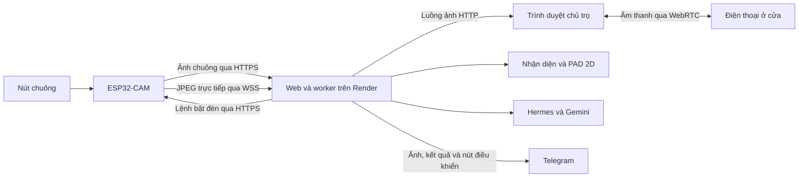

# Quản lý nhà trọ tích hợp chuông cửa thông minh

Đồ án Internet of Things tại HUIT. ESP32-CAM chụp ảnh khi có người bấm chuông, gửi ảnh lên web và báo cho chủ trọ qua Telegram. Web cũng quản lý phòng, người thuê, hợp đồng, hóa đơn và bảo trì.

## Cấu trúc mã nguồn

| Thư mục | Nội dung |
| --- | --- |
| [`firmware/`](firmware/) | Sketch Arduino cho AI Thinker ESP32-CAM và OV2640, nút chuông, chụp JPEG, camera trực tiếp và đèn mô phỏng mở cửa. |
| [`backend/`](backend/) | Ứng dụng Flask, giao diện web, cơ sở dữ liệu SQLite, bot Telegram và đàm thoại WebRTC. |
| [`hermes/`](hermes/) | Cấu hình Docker cho Hermes Agent và dịch vụ chuyển giọng nói, dùng Gemini để mô tả ảnh và hỗ trợ hội thoại. |
| [`face_service/`](face_service/) | API nội bộ chạy YuNet, SFace và PAD 2D để phát hiện, so khớp và đánh giá ảnh khuôn mặt. |

## Luồng hoạt động



ESP32 gửi ảnh ngay khi bấm chuông. Worker xử lý ảnh và báo Telegram, sau đó bổ sung mô tả Hermes khi có kết quả. Trên web, người thuê có thể hỏi Hermes về phòng của mình hoặc gửi yêu cầu sửa chữa. Đồ án mô phỏng mở cửa bằng đèn flash trên bo. PAD 2D đánh giá từ một ảnh tĩnh nên vẫn có thể phân loại sai.

## Chạy thử

Cài Python 3.13, sau đó chạy từ thư mục gốc. Lệnh sao chép dưới đây dùng PowerShell.

```powershell
python -m venv .venv
.\.venv\Scripts\python.exe -m pip install -r requirements.txt
Copy-Item backend/.env.rental.example backend/.env.rental
```

Đặt `RENTAL_ADMIN_PASSWORD` tối thiểu 16 ký tự trong `backend/.env.rental`. Sau đó khởi động web, worker và dịch vụ nhận diện nội bộ.

```powershell
.\.venv\Scripts\python.exe run_rental_local.py --single-house
```

Mở [bảng quản lý trên máy](http://127.0.0.1:5050) và đăng nhập bằng tên `chu-tro` cùng mật khẩu vừa đặt. Để dùng ESP32, Telegram hoặc Hermes, xem [hướng dẫn triển khai web](backend/README.md), [nạp Arduino](firmware/README.md) và [cấu hình Hermes](hermes/README.md).

## Kiểm thử

```powershell
.\.venv\Scripts\python.exe -m pip install -r requirements-dev.txt
.\.venv\Scripts\python.exe -m pytest -q
```

Giữ khóa thiết bị, API key, token Telegram, cấu hình Wi-Fi và dữ liệu nhà trọ trong cấu hình riêng. Giấy phép của các mô hình đóng gói nằm cạnh từng tệp trong [thư mục mô hình](face_service/faceid/models/).
