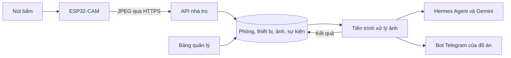

# Quản lý nhà trọ và chuông cửa IoT

## Phạm vi đồ án

Ở cấu hình một dãy, web quản lý các phòng ở **Dãy A** và tự tạo dãy khi khởi động. Chủ trọ thêm phòng, ghi nhận người thuê vào hoặc trả phòng, đăng ký chuông cửa chung, xem lịch sử và chọn nơi nhận Telegram. Chủ trọ có thể cấp tài khoản trực tiếp hoặc mời người thuê tự đăng ký bằng mã một lần. [Quy trình tài khoản và vận hành](../README.md)



Dữ liệu người thuê theo `houses → rooms → stays`, thiết bị cửa chung theo `houses → devices`. Sự kiện `visits` lưu dãy trọ tại thời điểm bấm chuông, thời gian, JPEG, trạng thái AI và Telegram. Khi nâng cấp từ bản gắn thiết bị theo phòng, hệ thống chuyển thiết bị và lượt bấm cũ về dãy của phòng tương ứng. API trả `202` sau khi lưu thành công. Bot gửi ảnh và kết quả nhận diện ngay sau khi xử lý PAD. Hermes xử lý mô tả ở luồng riêng. Web lưu mô tả vào lịch sử và bot cập nhật nội dung ngay trên tin nhắn ảnh đã gửi. Trạng thái giao ảnh chưa xác nhận cần đối chiếu trong chat trước khi gửi lại.

Web quản lý tài khoản theo vai trò, hợp đồng, hóa đơn điện nước và phiếu bảo trì. Nếu vận hành quy mô nhiều máy, chuyển sang PostgreSQL và lưu ảnh trong kho riêng. Trước khi dùng ảnh khách thật, thống nhất quyền xem, thời hạn lưu và quy trình xóa ở cả backend, Hermes và Telegram.

## Chạy trên máy

Tại thư mục `backend/`:

```powershell
python -m pip install -r requirements.txt
Copy-Item .env.rental.example .env.rental
# Đặt RENTAL_ADMIN_PASSWORD là mật khẩu ngẫu nhiên, ít nhất 16 ký tự.
python -m rental web --port 5050
```

Mở bảng quản lý, đăng nhập bằng `chu-tro` và mật khẩu quản trị. Trong mục **Chuông cửa chung**, nhập mã thiết bị để lấy khóa cho Dãy A. Có thể làm cùng việc này trong terminal. [Bảng quản lý](http://127.0.0.1:5050)

```powershell
python -m rental device doorbell-01
```

Sao chép khóa thiết bị từ terminal vào cấu hình riêng `firmware/esp32_doorbell/config.local.h`. Khi có URL HTTPS, đặt `DOORBELL_API_URL` thành URL đầy đủ kết thúc bằng `/api/device/doorbell`, `DOORBELL_DEVICE_ID` thành ID đã đăng ký và `DOORBELL_ROOT_CA` thành CA phát hành chứng chỉ. Xem [giao kèo firmware](../../firmware/API_CONTRACT.md).

Khởi động với `python -m rental web --with-worker` để xử lý sự kiện ngay trên máy chạy web. Nếu để trống cấu hình tích hợp, sự kiện hiển thị trạng thái chưa cấu hình. Thử một lượt bấm mới sau khi hoàn tất cấu hình.

## Đăng ký khuôn mặt ở cửa chung

Chạy [dịch vụ nhận diện](../../face_service/), rồi đặt `RENTAL_FACE_EMBED_URL` thành URL nội bộ của `POST /internal/embeddings` và `RENTAL_FACE_API_KEY` thành khóa dùng chung giữa hai dịch vụ. Có thể bắt đầu với bộ mẫu trống.

1. Thêm phòng và người thuê đang ở. Chọn **Mẫu khuôn mặt** dưới tên người thuê.
2. Tải ảnh JPG, PNG hoặc WebP có đúng một khuôn mặt, tối đa 8 MB. Có thể thêm tối đa 5 mẫu cho một người. Hệ thống lưu biểu diễn khuôn mặt, tên và phòng lấy từ hồ sơ đang thuê. Ảnh đăng ký chỉ dùng để trích xuất mẫu.
3. Khi có lượt bấm, worker đối chiếu ảnh với mẫu của những người đang ở cùng dãy. Nếu khớp đủ rõ, lịch sử và Telegram hiện ví dụ **Người thuê · Phòng 01** bên dưới vị trí **Dãy A · Cửa chung**. Một lượt có thể hiển thị nhiều người đã khớp.
4. Xóa từng mẫu từ web. Khi trả phòng, toàn bộ mẫu của lượt thuê đó được xóa khỏi bộ đối chiếu. Lịch sử sự kiện đã lưu vẫn phản ánh kết quả tại thời điểm xử lý.

## Hermes và Telegram

1. Dùng một Hermes riêng của đồ án trên VPS hoặc container riêng, chạy bằng tài khoản dịch vụ và giữ API trong mạng nội bộ. Bật `API_SERVER_ENABLED`, đặt `API_SERVER_KEY`, chọn Gemini có hỗ trợ ảnh. Đặt `agent.image_input_mode: native` và `platform_toolsets.api_server: []` trong cấu hình của Hermes. Dùng bản có `/v1/toolsets` và tìm nguyên nhân nếu API còn báo công cụ được bật. Worker xác minh danh sách công cụ trước khi gửi ảnh. [API Hermes](https://hermes-agent.nousresearch.com/docs/user-guide/features/api-server) · [Nhận ảnh](https://hermes-agent.nousresearch.com/docs/user-guide/features/vision)
2. Điền `RENTAL_HERMES_URL` (URL nội bộ kết thúc bằng `/v1`), `RENTAL_HERMES_KEY` và tên model API do Hermes công bố nếu tên khác `hermes-agent`.
3. Cấu hình `RENTAL_TELEGRAM_BOT_TOKEN` bằng token của bot riêng của đồ án. Mở chat riêng với bot, nhấn **Start** và lưu Chat ID ở mục **Thông báo Telegram** của dãy. Ảnh chuông mới trong chat riêng có nút **Mở cửa mô phỏng**. Bot gửi ảnh tới nhóm nếu cấu hình Chat ID của nhóm. Nút điều khiển dành cho chat riêng đã được chủ trọ cấu hình. [Telegram Bot API](https://core.telegram.org/bots/api#sendphoto)

Worker nhận nút bấm bằng `getUpdates`. Để một worker nhà trọ nhận cập nhật của bot. Hermes gọi qua API riêng và dùng bot riêng nếu cần giao diện Telegram cho Hermes. Nếu Telegram báo xung đột `409`, kiểm tra webhook và worker đang dùng token. [Cách nhận cập nhật Telegram](https://core.telegram.org/bots/api#getupdates)

Phiên Telegram Web dành cho người dùng. Cấu hình khóa API và token bot trực tiếp trong `.env.rental` hoặc kho biến môi trường của máy chủ. Với ảnh chụp cửa, Hermes có nhiệm vụ mô tả những gì nhìn thấy và có thể giải thích kết quả PAD 2D. Kết quả này là đánh giá của mô hình chuyên dụng trên một ảnh tĩnh.

Nhận diện theo hồ sơ và mô tả từ Hermes có thể chạy cùng nhau. `RENTAL_FACE_API_URL` dành cho chế độ cũ chỉ đếm số mặt khớp, dùng khi `RENTAL_FACE_EMBED_URL` để trống.

## Đưa lên máy chủ

Chạy web và worker trên cùng máy với một đường dẫn `RENTAL_DB_PATH` tuyệt đối trên ổ lưu bền vững. Dùng reverse proxy HTTPS cho web, bật `RENTAL_COOKIE_SECURE=1` và giữ khóa Hermes/token bot trong cấu hình riêng của worker. Khi dùng SQLite tránh đặt web và worker trên hai dịch vụ có ổ đĩa khác nhau. Mở frontend cho chủ trọ sau khi thiết lập mật khẩu mạnh. Camera gọi HTTPS, dashboard được bảo vệ bằng đăng nhập và ảnh nằm trong cơ sở dữ liệu thay vì URL công khai.

Chạy kiểm thử từ thư mục gốc theo [hướng dẫn kiểm thử](../../README.md#kiểm-thử).
